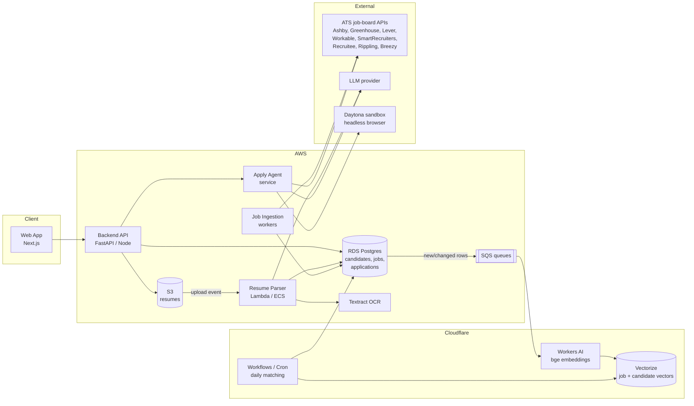
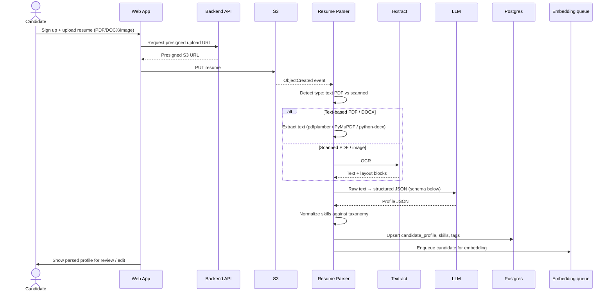
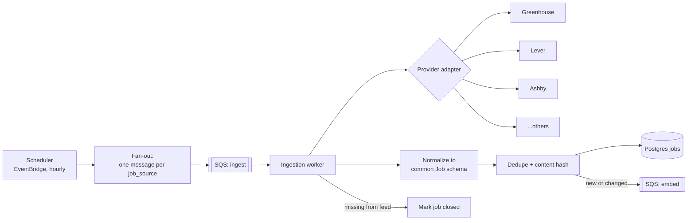
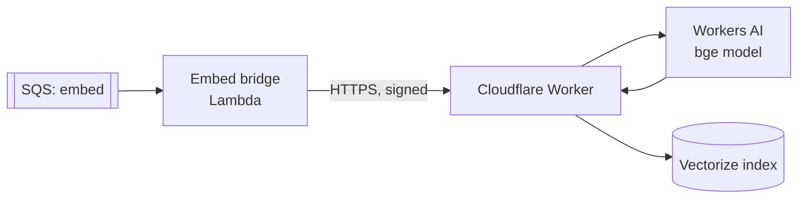
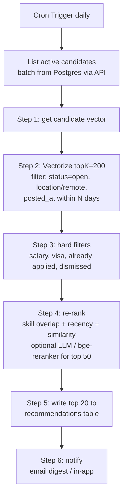
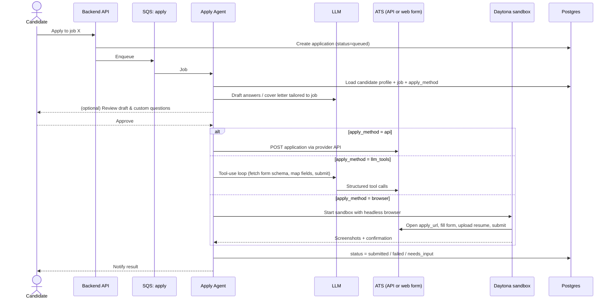
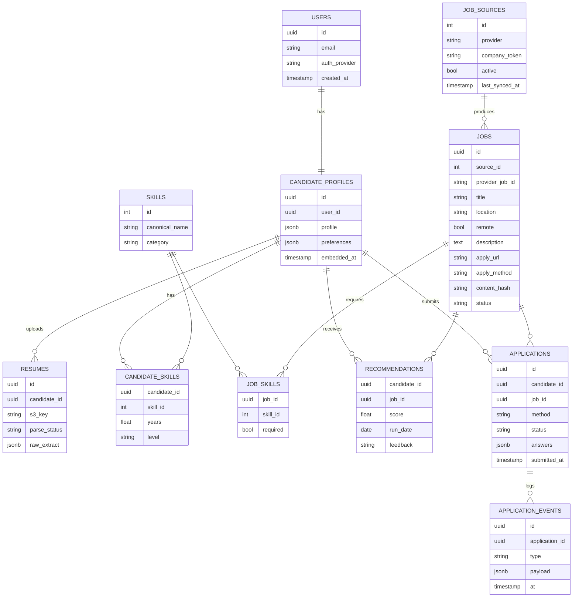

# Upwork ATS — Architecture

> Status: **design only**. Nothing in this document is implemented yet.

A job search portal that:

1. Lets candidates register and upload a resume, then extracts structured profile data (skills, tags, experience) with OCR + PDF parsing.
2. Pulls jobs from public ATS job-board APIs into an AWS database, embeds them with a BGE model on Cloudflare, and runs a daily semantic-matching workflow that produces per-candidate recommendations.
3. Lets a candidate click a job and have an AI agent submit the application for them — via API where possible, otherwise via LLM tool use or a sandboxed browser (Daytona).

---

## 1. System overview



| Layer | Choice | Why |
|---|---|---|
| Frontend | Next.js (React) | SSR for job pages, simple auth integration |
| Backend API | FastAPI (Python) | Same language as parsing / ML / agent code |
| Auth | AWS Cognito (or Clerk/Auth0) | Email + OAuth (Google, LinkedIn) |
| System of record | AWS RDS Postgres | Relational data: candidates, jobs, applications |
| File storage | AWS S3 | Resumes, generated cover letters, screenshots from apply runs |
| Queues | AWS SQS | Decouple parsing, ingestion, embedding, apply jobs |
| OCR | AWS Textract | Scanned / image resumes |
| Embeddings | Cloudflare Workers AI — `@cf/baai/bge-base-en-v1.5` (768-d) or `bge-large-en-v1.5` (1024-d), `bge-m3` for multilingual | Cheap, serverless, no GPU ops |
| Vector DB | Cloudflare Vectorize | Lives next to Workers AI; metadata filtering |
| Scheduling | Cloudflare Workflows + Cron Triggers | Durable, retryable daily matching run |
| Agent sandbox | Daytona | Isolated browser environment per application run |

---

## 2. Module 1 — Candidate registration & resume parsing

### Flow



### Parsing pipeline

1. **Type detection** — if the PDF has an extractable text layer with reasonable density, use the PDF parser; otherwise route to OCR.
2. **Text extraction** — `pdfplumber` / `PyMuPDF` for text PDFs, `python-docx` for DOCX, AWS Textract for scans and images.
3. **Structured extraction** — LLM call with a strict JSON schema (function calling / structured output). Rule-based fallbacks for email, phone, URLs.
4. **Normalization** — map raw skills to a canonical taxonomy (e.g. ESCO / O*NET or an internal list): `"ReactJS"`, `"React.js"` → `react`. Compute years of experience per skill from dated roles.
5. **Human review** — candidate confirms/edits the parsed profile before it is used for matching or applications.

### Extracted profile (ATS fields)

```json
{
  "name": "", "email": "", "phone": "", "location": "",
  "links": { "linkedin": "", "github": "", "portfolio": "" },
  "headline": "",
  "summary": "",
  "skills": [{ "name": "python", "years": 5, "level": "expert" }],
  "tags": ["backend", "fintech", "remote-ok"],
  "experience": [{ "title": "", "company": "", "start": "", "end": "", "highlights": [] }],
  "education": [{ "degree": "", "school": "", "year": "" }],
  "certifications": [],
  "languages": [],
  "preferences": {
    "titles": [], "locations": [], "remote": true,
    "min_salary": null, "visa_sponsorship_needed": false
  }
}
```

Preferences come from an onboarding form, not the resume.

---

## 3. Module 2 — Job ingestion, embeddings & daily recommendations

### 3.1 Job sources

All of these expose public job-board / posting endpoints keyed by a company's board token, so ingestion is driven by a **`job_sources` table** listing (provider, company slug/token).

| Provider | Typical public endpoint (read) |
|---|---|
| Greenhouse | `boards-api.greenhouse.io/v1/boards/{token}/jobs?content=true` |
| Lever | `api.lever.co/v0/postings/{company}?mode=json` |
| Ashby | `api.ashbyhq.com/posting-api/job-board/{board}` |
| Workable | `apply.workable.com/api/v1/widget/accounts/{account}` |
| SmartRecruiters | `api.smartrecruiters.com/v1/companies/{company}/postings` |
| Recruitee | `{company}.recruitee.com/api/offers` |
| Breezy HR | `{company}.breezy.hr/json` |
| Rippling | `ats.rippling.com/{company}/jobs` (board pages / API where available) |

Endpoints must be verified per provider at implementation time; each gets its own adapter.

### 3.2 Ingestion design



- **Adapter pattern**: `fetch(source) -> list[RawJob]`, `normalize(RawJob) -> Job`. Adding a provider = adding one adapter.
- **Common Job schema**: `id, provider, provider_job_id, company, title, department, location, remote, employment_type, salary_min/max, description_html, description_text, apply_url, apply_method, posted_at, updated_at, content_hash, status`.
- **Change detection**: `content_hash` of normalized fields; only re-embed when it changes.
- **Closing jobs**: jobs that disappear from a source feed are marked `closed` and removed from Vectorize.
- **Rate limiting / politeness**: per-provider concurrency limits, backoff, respect `robots`/ToS.

### 3.3 Embedding (Cloudflare)



- **What gets embedded**
  - Job: `title + seniority + key skills + cleaned description` (truncated to the model's 512-token limit; long descriptions are summarized or chunked first).
  - Candidate: `headline + skills + recent roles + preferences` built from the parsed profile.
- **Indexes**: `jobs` and `candidates` in Vectorize, same model and dimensions. Use BGE's query instruction prefix for candidate (query) side.
- **Metadata on job vectors** for filtering: `job_id, provider, company, location, remote, employment_type, posted_at, salary_min, status`.
- **IDs**: Vectorize vector id = Postgres `job_id` / `candidate_id`, so Postgres stays the source of truth.

Alternative considered: `pgvector` in RDS. Simpler (one DB), but the user asked for the Cloudflare embedding path; pgvector remains a fallback.

### 3.4 Daily recommendation workflow

Runs once per day per candidate as a **Cloudflare Workflow** triggered by a Cron Trigger (durable steps, automatic retries).



**Score** (initial, tunable):

```
score = 0.6 * cosine_similarity
      + 0.25 * skill_overlap(candidate.skills, job.required_skills)
      + 0.15 * recency_decay(job.posted_at)
```

User feedback (clicked, saved, dismissed, applied) is stored and later used to tune weights.

---

## 4. Module 3 — AI apply agent

Candidate clicks **Apply with AI** on a job. An agent fills and submits the application on their behalf.

### 4.1 Flow



### 4.2 Strategy per method

| Method | When | Notes |
|---|---|---|
| **API** | Provider supports application submission (e.g. Greenhouse / Lever / Ashby application endpoints) | Most reliable. Many providers require the *employer's* API key for submission, so this path may only be available via partnerships. |
| **LLM tools** | Form schema is discoverable (job-board API returns question list) | LLM maps profile → fields, generates answers to custom questions, calls a `submit_application` tool. |
| **Browser sandbox (Daytona)** | Everything else (generic web forms) | Each run in an isolated, ephemeral Daytona workspace with a headless browser (Playwright) driven by the agent. Captures screenshots / HAR for audit. **Phase 3 — later.** |

### 4.3 Agent tools (planned)

- `get_candidate_profile(candidate_id)`
- `get_job(job_id)` / `get_application_questions(job_id)`
- `generate_cover_letter(candidate, job)`
- `answer_question(question, candidate, job)`
- `submit_application_api(provider, job, payload)`
- `browser_session(apply_url)` → `navigate`, `fill`, `upload_file`, `click`, `screenshot`
- `request_user_input(question)` — pause when an answer cannot be inferred (salary, legal questions, EEO)

### 4.4 Guardrails

- Candidate must explicitly authorize each application (or opt in to auto-apply with rules).
- Never invent qualifications; answers are grounded in the stored profile.
- Sensitive questions (work authorization, EEO, salary) require candidate-provided answers.
- Daily per-user apply limits; full audit log (inputs, outputs, screenshots) per application.
- Respect each ATS / employer site's terms of service.

---

## 5. Data model (Postgres)



---

## 6. Security & privacy

- Resumes contain PII: S3 with SSE-KMS, private bucket, presigned URLs only; RDS encrypted at rest.
- Only the minimum profile text is sent to Cloudflare / LLM providers; no raw resume files leave AWS except for submission to the target ATS.
- AWS ↔ Cloudflare calls authenticated with signed requests / service tokens.
- Secrets in AWS Secrets Manager and Cloudflare secrets.
- Account deletion removes S3 objects, Postgres rows and Vectorize vectors (GDPR/CCPA).
- Daytona sandboxes are ephemeral and destroyed after each run; no candidate data persists in them.

## 7. Observability

- Structured logs (CloudWatch + Workers Logs), traces via OpenTelemetry.
- Metrics: parse success rate, jobs ingested per source, embedding lag, recommendation CTR, apply success rate per method/provider.
- Dead-letter queues on every SQS queue.

---

## 8. Repository layout (proposed)

```
upwork-ats/
├── architecture.md
├── apps/
│   └── web/                  # Next.js frontend
├── services/
│   ├── api/                  # FastAPI backend
│   ├── resume-parser/        # OCR + PDF parsing + LLM extraction
│   ├── job-ingestion/        # provider adapters + normalizer
│   │   └── adapters/         # greenhouse.py, lever.py, ashby.py, ...
│   └── apply-agent/          # agent, tools, Daytona integration
├── cloudflare/
│   ├── embed-worker/         # Workers AI + Vectorize upsert/delete
│   └── daily-match-workflow/ # Cloudflare Workflow + Cron Trigger
├── infra/                    # IaC: AWS CDK/Terraform + wrangler configs
└── packages/
    └── schemas/              # shared Job / Profile JSON schemas
```

## 9. Delivery phases

| Phase | Scope |
|---|---|
| **1** | Auth, resume upload, parsing (PDF + OCR), profile review UI |
| **2** | Job ingestion (Greenhouse, Lever, Ashby first, then the rest), embeddings on Cloudflare, daily recommendations + email digest |
| **3** | Apply agent: API + LLM-tools methods, human-in-the-loop review |
| **4** | Daytona browser-sandbox apply path, auto-apply rules, feedback-driven ranking |

## 10. Open questions

- Which BGE variant: `bge-base` (cheaper, 768-d) vs `bge-large` (better, 1024-d) vs `bge-m3` (multilingual)?
- How is the list of company board tokens seeded and grown (manual list, crawling career pages, partner feeds)?
- Do we pursue employer partnerships to get submission API keys, or rely on browser automation?
- Auto-apply vs per-job approval as the default?
